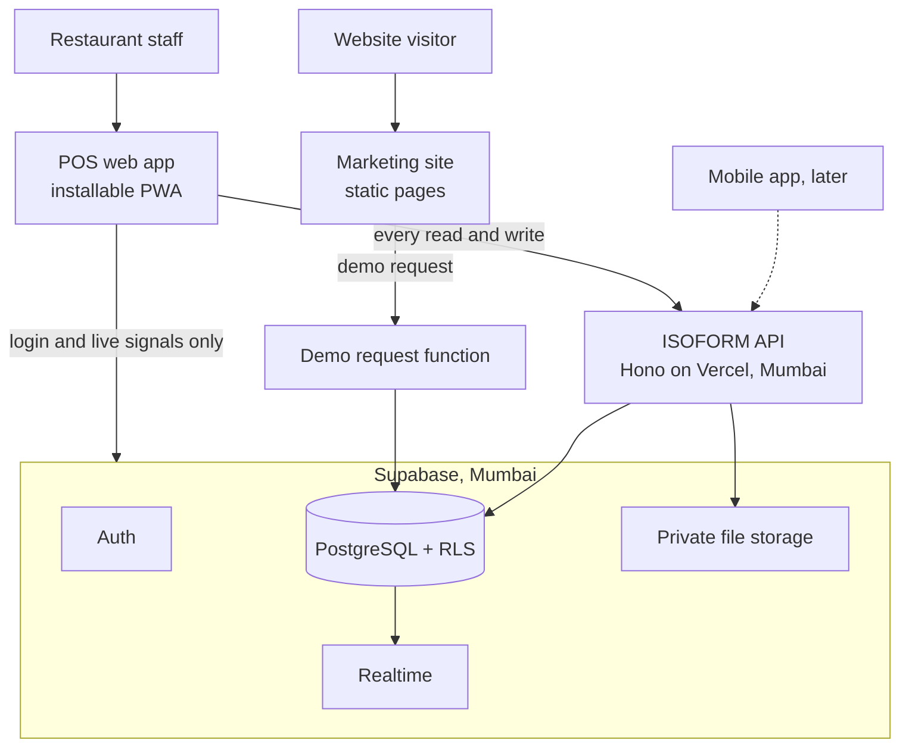
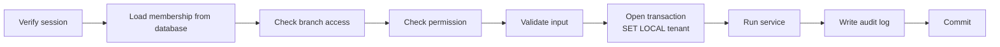
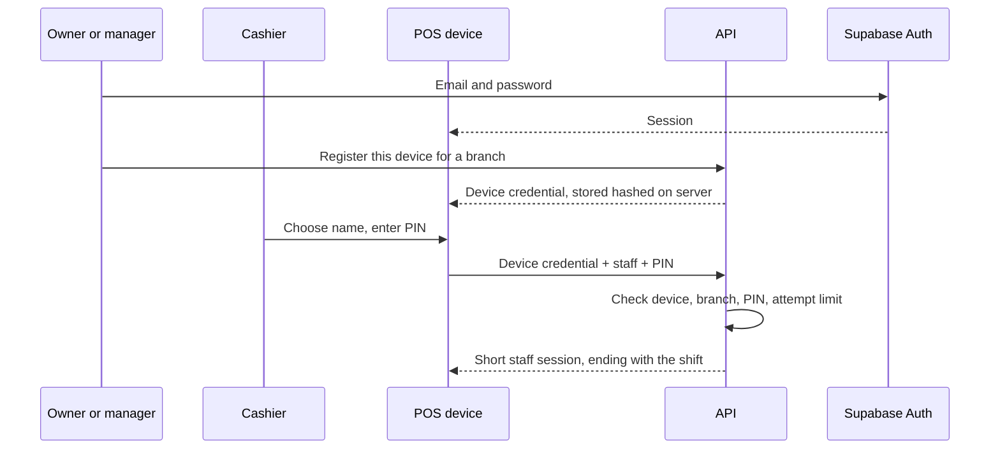
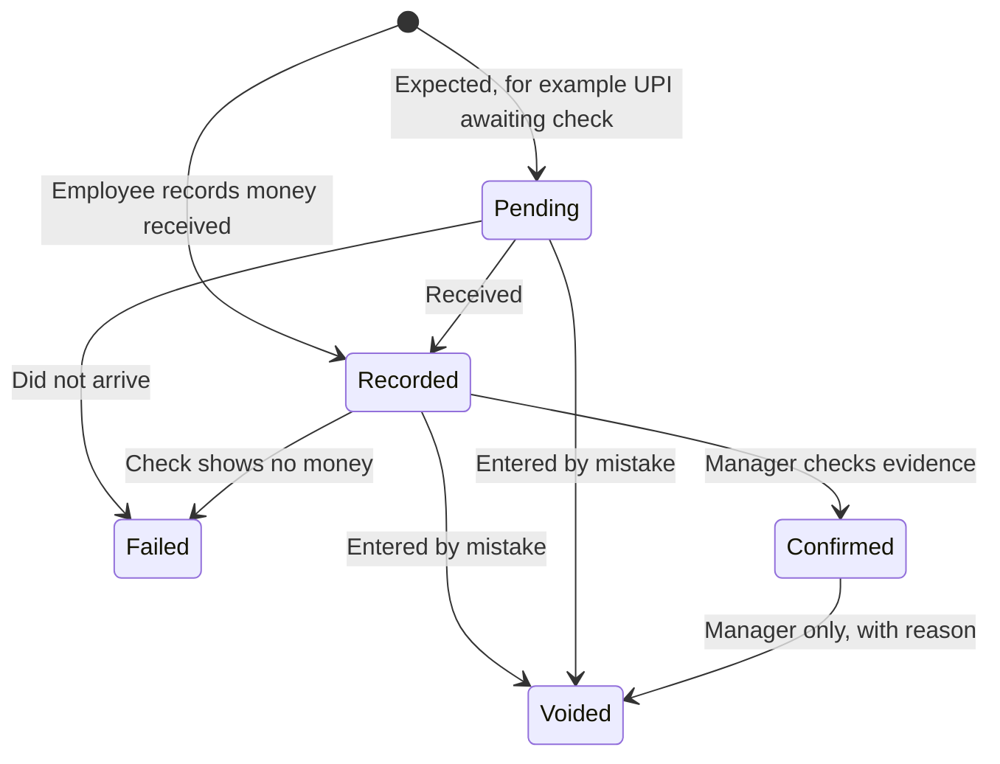
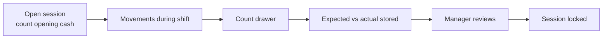

# ISOFORM POS: Stage 2, System Architecture

Status: **Approved on 30 October 2026.** Section 14 is answered in [03-database-design.md](03-database-design.md).
Date: 30 October 2026
Builds on [01-architecture-discovery.md](01-architecture-discovery.md). No POS code exists yet.

## Decisions already made

| Question | Decision |
|---|---|
| Q1 Offline | Offline-ready foundations now. Offline billing ships before wider rollout |
| Q2 Staff login | Email for owners and managers. PIN on a registered device for other staff |
| Q3 First release | Registration, staff, branches, menu, orders, billing, payments, cash, basic reports |
| Q4 Joining | Request a demo, then ISOFORM activates the business. Pricing shown as plans |
| Q5 Domain | Not chosen yet. Main domain for the site, `app.` subdomain for the POS |

---

## 1. System overview



**In plain terms:** the POS asks our API to do things. The API checks who is asking, applies the rules and writes to the database. Live updates only tell a screen "something changed, fetch again". The money rules exist in one trusted place.

---

## 2. Project structure

One repository holding every part:

```
isoform-pos/
├── apps/
│   ├── site/          Marketing site (React, GSAP, React Bits, pre-rendered)
│   ├── pos/           POS web app (later wrapped for mobile)
│   └── api/           Hono API, organised by module
├── packages/
│   ├── contracts/     Request and response shapes, permission names
│   └── billing/       Tax and rounding calculations
├── supabase/
│   └── migrations/    Every database change, as SQL files
├── brand/             Logo sources
└── docs/              This documentation
```

The POS uses `packages/billing` to show totals instantly. **The API recalculates everything and its answer is final.**

---

## 3. Frontend architecture

**Marketing site:** static HTML for every page, with GSAP motion layered on top. It has no access to POS data.

**POS app:** organised by feature, matching the backend modules.

| Concern | Choice | Reason |
|---|---|---|
| Server data | TanStack Query | Caching, retry and refetch handled for us |
| Screen state | React state, small stores only where needed | No heavy global store |
| Offline foundation | Service worker caches the app shell. Menu kept in IndexedDB | Screen still opens on a bad connection |
| Permissions in UI | Hides unavailable actions | Convenience only. The API still enforces them |

### Offline-ready rules, from day one

These cost little now and avoid a rewrite later:

1. **The device creates record IDs**, using UUIDv7, so an order has an identity before reaching the server.
2. **Writes are named commands**, such as "finalise invoice", not "update row". A queue can replay them later.
3. **Every command has an idempotency key**, so a replay cannot create a duplicate.
4. **Invoice series can belong to a register**, so a device can number bills without asking the server.

---

## 4. Backend architecture

A **modular monolith**: one deployable API, with firm boundaries inside it.

```
apps/api/src/
├── platform/        Session, tenant context, permissions, idempotency, audit, errors
└── modules/
    ├── tenancy/     Businesses, tax registrations, branches, settings
    ├── identity/    Users, staff, devices, PIN sessions, invitations
    ├── catalog/     Categories, products, variants, add-ons, prices
    ├── orders/      Orders, items, status history
    ├── billing/     Bills, invoices, credit notes, numbering
    ├── payments/    Records, allocations, verification, refunds, reconciliation
    ├── cash/        Registers, sessions, movements
    └── reports/     Summaries and report queries
```

Later modules (tables, kitchen, inventory, purchases, expenses, subscriptions) follow the same shape.

Each module has three layers: **routes** (check input), **service** (rules) and **repository** (database). A module may call another module's service, but never reach into its tables.

Every request passes through the same steps:



Background work (daily summaries, stale-session checks) uses scheduled Vercel jobs. No message queue is needed yet.

---

## 5. Database architecture

The full schema comes at Stage 3. The rules it will follow:

- PostgreSQL with RLS on every business table.
- The API connects through Supabase's transaction pooler (port 6543) as a restricted role called `app_user`. That role cannot bypass RLS.
- Tenant context is set per transaction with `SET LOCAL`, which is safe on shared connections.
- Financial tables grant `INSERT` and `SELECT` only.
- Composite foreign keys keep every relationship inside one tenant.
- Migrations run through the Supabase CLI. Nobody edits production by hand.

**Prepared statements are unavailable in transaction mode**, so the database client must be configured for that. This is tested at Stage 4.

---

## 6. Authentication

Two ways in, resulting in one kind of session.



- **A PIN alone is worthless.** It only works on a device a manager registered, for staff assigned to that branch.
- Five wrong attempts lock that staff member on that device until a manager unlocks them.
- PINs are stored as slow hashes (Argon2id), never in plain text.
- **Risky actions need a manager's approval on the spot:** voids, refunds, large discounts and verifying payments.
- Removing a device or employee takes effect on their next request, since membership is checked live.

**Technical unknown to prove at Stage 4:** staff sessions need to work with Supabase Realtime and RLS. The plan is for each PIN user to have a hidden Supabase Auth account, with the API creating sessions on their behalf. I will prototype this first. If it fails, the fallback is API-issued sessions with live updates delivered through the API.

---

## 7. Tenant isolation

See [section 4 of the discovery document](01-architecture-discovery.md#4-multi-tenant-and-multi-branch-architecture) for the four layers. An example policy:

```sql
create policy tenant_isolation on orders
  using (tenant_id = (select current_setting('app.tenant_id')::uuid));
```

The `(select ...)` wrapper makes Postgres evaluate the value once instead of on every row. `tenant_id` comes first in every index.

**The tests are the proof.** A suite creates two businesses and tries to read and change each other's data through every endpoint. Any success fails the build.

---

## 8. Branch strategy

- `branch_id` lives on operational records: orders, invoices, payments, registers, sessions, expenses and stock.
- The menu belongs to the business, with per-branch overrides for price and availability.
- Reports filter to the branches a user may see. Owners default to all branches.
- The active branch is sent with each request and **checked against the user's assignments**, never trusted.
- Single-branch businesses skip the branch picker.

---

## 9. API structure

- Hosted at `app.<domain>/api/v1`, on the same domain as the POS so no cross-site setup is needed.
- The tenant always comes from the session, **never from the URL or body**.

| Rule | Detail |
|---|---|
| Writes | `Idempotency-Key` header required on all commands |
| Conflicts | Orders carry a version. A stale save returns `409` with the latest state |
| Lists | Cursor pagination, 50 items by default |
| Errors | Same shape everywhere: `{ code, message, details }` |
| Money | Decimal strings such as `"1050.00"`, never JSON numbers |
| Rate limits | Stricter on login, PIN and demo requests |

Example commands:

```
POST /api/v1/orders
POST /api/v1/orders/:id/items
POST /api/v1/orders/:id/finalize            Create the numbered invoice
POST /api/v1/invoices/:id/credit-notes      Correct an issued invoice
POST /api/v1/payments                       Record a payment with allocations
POST /api/v1/payments/:id/confirm
POST /api/v1/payments/:id/refunds
POST /api/v1/cash-sessions                  Open a session
POST /api/v1/cash-sessions/:id/close
GET  /api/v1/reports/daily-sales
```

---

## 10. Financial workflows

### Finalising an invoice

All of this happens in **one transaction**. If any step fails, nothing is saved.

1. Lock the order and check its version.
2. Recalculate prices, discounts and tax on the server.
3. Lock the invoice counter for this series and financial year.
4. Take the next number. Example: `CBE1-2627-000123`, exactly 16 characters.
5. Write the invoice and line snapshots, then lock the order.
6. Write the audit record.

Because the counter is locked inside the transaction, a failure rolls the number back, which leaves no gap.

### Correcting money

| Situation | What happens |
|---|---|
| Mistake before finalising | Edit the draft |
| Wrong invoice after issuing | Credit note. The original stays |
| Payment recorded by mistake | Marked voided with a reason. The record stays |
| Customer refund | New refund record linked to the payment |
| Expense error | Reversal plus a new record |
| Cash count difference | Stored on the session, reviewed, never adjusted away |

The exact GST treatment of corrections needs an accountant's review.

---

## 11. Payment recording and verification



| Action | Who can do it |
|---|---|
| Record a payment | Cashier, Manager, Owner |
| Confirm or mark failed | Manager, Accountant, Owner |
| Void | Manager or Owner, with a reason |
| Record a refund | Manager or Owner |

`Voided` is an addition to your list, covering entries that were simply mistakes. It is different from `Failed`, which means a real attempt where the money never arrived.

**Refund state is calculated**: total refunds compared with the payment amount gives "Partially refunded" or "Refunded".

**Rules the database enforces:**

- Allocations cannot exceed the payment amount.
- Allocations cannot exceed the invoice's balance.
- A reference number can appear only once per business and payment method.
- Duplicate submissions are rejected by the idempotency key.

Confirmed cash comes from the session count. Bank import for reconciliation is a later feature, and until then this is manual.

---

## 12. Cash and expenses

### Cash



- One open session per register at a time, enforced by a partial unique index.
- A cash payment writes the payment and its movement in the same transaction.
- Movements are never edited. A correction is a new linked movement.

### Expenses (after the first release)

- Expenses are recorded against a branch and category, and can need approval.
- If paid from the drawer, a cash movement is created in the same transaction.
- Receipts are stored in private tenant-scoped folders, with file type and size checked.

### Report definitions

Each number has one definition, written down before any report is built.

| Figure | Meaning |
|---|---|
| Billed sales | Issued invoices minus credit notes, excluding tax |
| Tax collected | Tax on those invoices |
| Payments recorded | Recorded plus confirmed, excluding failed and voided |
| Payments confirmed | Confirmed only |
| Outstanding | Invoice totals minus allocated payments, plus refunds that reopen a balance |
| Refunds | Recorded refunds |
| Cash variance | Actual minus expected, per closed session |

The first release shows no profit figure. Later versions will label any profit figure as an estimate unless stock and cost data are complete.

---

## 13. Revised build order

1. Foundation: repository, database roles, RLS harness, CI
2. Business activation and tenant setup
3. Authentication, devices and PINs
4. Branches, staff and permissions
5. Menu
6. Orders
7. Billing and invoices
8. Payments
9. Cash
10. Basic reports

**Pilot milestone: a real restaurant can run a shift.** Then tables, kitchen, offline billing, inventory, purchases, expenses, advanced reports, subscription admin.

---

## 14. Next-round questions

Answered during Stage 3, because they change the schema.

1. **Customers and credit:** do you need customer records or running tabs?
2. **Swiggy and Zomato:** will those orders be entered in ISOFORM?
3. **Printers:** what will the first restaurants use?
4. **Tips:** recorded or ignored?
