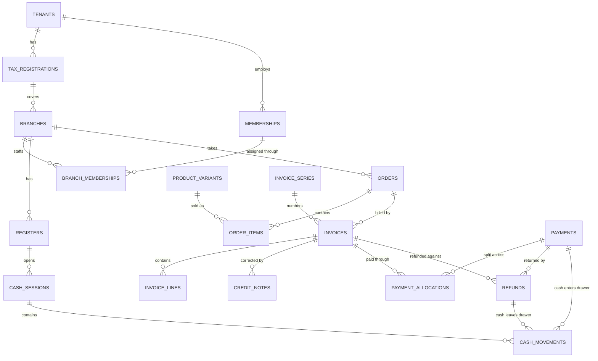

# ISOFORM POS: Stage 3, Database Design

Status: **Proposed, waiting for product-owner approval**
Date: 30 October 2026
Builds on [02-system-architecture.md](02-system-architecture.md).

| File | Purpose |
|---|---|
| [schema/first-release-draft.sql](schema/first-release-draft.sql) | Every first-release table, column, constraint, index and policy. **This is the source of truth for column definitions** |
| [schema/verify-schema.mjs](schema/verify-schema.mjs) | 94 automated checks that attack the schema. Run with `npm run verify:schema` |

The schema is a proposal. It has not been applied to any Supabase project, and there are no POS migrations yet.

---

## 1. Decisions confirmed

| Topic | Decision |
|---|---|
| Stage 2 | Approved on 30 October 2026 |
| Customers and credit | A simple customer record (name, phone), created only for bills with an outstanding balance. No loyalty programme yet |
| Swiggy and Zomato | Entered by hand as their own order type. Automatic integration later |
| Printers | 80mm thermal through the browser print dialog first. No schema impact |
| Tips | Stored separately from sales, in `payments.tip_amount` |

---

## 2. The shape of the design

**36 tables in the first release, grouped into seven areas.** They live in a private `app` schema, because Supabase automatically publishes the `public` schema as a web API. Keeping tables out of `public` means a browser has no route to them, even if a setting is wrong.

| Area | Tables |
|---|---|
| Business | `tenants`, `tax_registrations`, `branches` |
| People and devices | `memberships`, `branch_memberships`, `devices`, `device_pin_attempts`, `invitations`, `customers` |
| Menu | `tax_rates`, `categories`, `products`, `product_variants`, `addons`, `product_addons`, `branch_variant_overrides` |
| Orders | `orders`, `order_items`, `order_item_addons`, `order_discounts`, `order_status_history` |
| Billing | `invoice_series`, `invoices`, `invoice_lines`, `credit_notes`, `credit_note_lines` |
| Payments | `payment_methods`, `payments`, `payment_allocations`, `refunds`, `financial_status_history` |
| Cash and platform | `registers`, `cash_sessions`, `cash_movements`, `idempotency_keys`, `audit_log` |

### Where the design differs from the initial list in the brief

| Listed in the brief | What I did | Why |
|---|---|---|
| `roles`, `permissions` | Role is a column, permissions live in code | Fixed roles for now. Custom roles can add tables later |
| `payment_references` | A column on `payments` | A payment has one reference |
| `payment_verifications` | `financial_status_history` | Records every status change, including verification |
| `business_settings` | Columns on `tenants` | One row per business needs no second table |
| `users` | Supabase's `auth.users` plus `memberships` | A person's name and role belong to each business |
| Draft bills | Not stored | A draft is the open order. Totals are calculated by the API, and only the final invoice is stored |

---

## 3. Entity relationships

The money path, simplified. Every table also has `tenant_id`, and most have `branch_id`.



---

## 4. Keys and relationships

- **Primary keys** are UUIDs. Orders, invoices, payments and refunds take an ID created by the device, which supports offline use and stops a retry from creating a second record.
- **Composite foreign keys** carry `tenant_id` in every link. An order item physically cannot point at another business's product, even if our code tried to.
- **Branch-level links** also carry `branch_id`. A branch 1 invoice cannot belong to a branch 2 order.
- **`on delete restrict`** applies throughout. Deleting a business can never cascade through its financial history.
- **Payment methods** link on `(tenant_id, id, kind)`, so a card method cannot be stored as cash.

---

## 5. How the financial data fits together

### One worked example

A ₹1,000 bill paid with ₹300 cash, ₹500 UPI and ₹200 card:

| Record | Rows | Note |
|---|---|---|
| `invoices` | 1 | Number assigned by the database, totals locked |
| `invoice_lines` | One per item | Prices and tax copied in, so menu changes never alter it |
| `payments` | 3 | One per method |
| `payment_allocations` | 3 | Links each payment to the invoice |
| `cash_movements` | 1 | The ₹300 enters the open cash session |

The balance is always calculated:

```
Outstanding = invoice total − credit notes − allocations + live refunds
```

### Rules the database enforces

| Rule | How |
|---|---|
| Invoice numbers cannot be typed in | A trigger assigns them and ignores any supplied value |
| Numbers run in order, with no gaps from failed bills | The counter updates inside the transaction, so a rollback restores it |
| Series match the document | A credit-note series cannot number an invoice, and a series belongs to one branch, registration and financial year |
| An April bill cannot use last year's series | The invoice date is checked against the series |
| A regular business cannot issue a bill of supply, and a bill of supply cannot charge GST | Trigger and check constraint |
| Invoice totals equal their lines | Checked at commit, including if a line is added later |
| An order item cannot be billed twice | Billed quantity is checked per item |
| Allocations cannot exceed the payment or the bill | Trigger, with a per-record lock |
| Refunds cannot exceed what the payment contributed | Trigger, with a per-record lock |
| A voided payment leaves nothing behind | At commit, its allocations and drawer entries must net to zero |
| A cash payment must be in the drawer | Checked at commit |
| The person who recorded a payment cannot confirm it | Trigger, unless the business turns on `allow_self_verification` |
| The person who closed a session cannot review it | Same setting |
| Expected cash cannot be supplied | The API role has no permission to write it, and a trigger calculates it |
| A closed session is locked | No new movements, and the count cannot change |

### Status history

`amount`, `reference` and other payment details cannot be updated. The API role can change only `status` and `status_reason`. The database fills in who made the change and writes the history row, so neither can be faked.

### Two dates on every bill

- **`invoice_date`** is the real calendar date, used for GST.
- **`business_date`** is the trading day, used for reports.

A bill at 12:30 AM on 1 April has a business date of 31 March, but must use the new financial year's series. Storing both avoids a mistake that a single date would force.

---

## 6. Tenant and branch security

### Row Level Security

Every table has RLS on and **forced**, which means even the table owner is filtered.

| Table type | Policy |
|---|---|
| Business-wide tables (menu, customers, methods) | `tenant_id` must match the request |
| Branch tables (orders, invoices, payments, cash) | `tenant_id` must match, and `branch_id` must be in the user's branches |
| `tenants` | Read and edit your own row only. Account status cannot be changed |
| `memberships` | Also readable by the user themselves, so the API can find their business at login |

The API sets `app.tenant_id`, `app.membership_id` and `app.branch_ids` with `SET LOCAL` for each transaction. If a value is missing, the result is no rows rather than all rows.

### Database roles

| Role | Used by | Can do |
|---|---|---|
| `app_user` | The API | Only what is granted. Cannot bypass RLS |
| `app_platform` | Activating businesses, cleanup jobs | Defined at Stage 4, used by a separate admin path |
| Migration role | Supabase CLI | Schema changes only |

Browsers use neither. Supabase's `anon` and `authenticated` roles get no access to `app`.

### Append-only tables

`invoices`, `invoice_lines`, `credit_notes`, `credit_note_lines`, `payment_allocations`, `cash_movements`, `financial_status_history` and `audit_log` allow only `SELECT` and `INSERT`.

---

## 7. Indexing strategy

32 indexes support everyday screens and reports, in addition to those created by keys and unique rules.

- `tenant_id` and `branch_id` come first, which also keeps RLS fast.
- Date-based lists use `business_date desc`.
- Partial indexes cover the rows staff check most: open orders and unverified payments.
- Two partial unique indexes carry business rules: one open session per register, and one live payment per reference number.

Policies wrap their context in `(select ...)`, so Postgres evaluates it once per query. Real speed still needs measuring, see section 9.

---

## 8. Security and consistency review

### Results

| Check | Result |
|---|---|
| Rule checks on a real PostgreSQL engine | **94 of 94 pass** |
| Deliberate breaks to the schema (filters removed, guards dropped, deletes allowed) | **10 of 10 caught** by the tests |

Checks cover tenant isolation, branch access, invoices, payments, refunds, credit notes, cash and database privileges.

### Problems the review found and fixed

The first version passed its tests, so I reviewed it by trying to break it. These were real gaps:

| Problem | Fix |
|---|---|
| **A reversal could reference another business's allocation**, which would falsify a balance | Reversals and corrections now use tenant-bound keys, and a missing original is rejected |
| An invoice could use a hand-typed number | The database now assigns every number |
| An invoice could use the wrong branch's series, or a credit-note series | Series are bound to branch, registration and document type |
| A line could be added to an invoice after it was issued | Totals are rechecked for every new line |
| A split bill could charge the same item twice | Billed quantity is checked |
| Discounts could be added to a closed order | Discounts and add-ons now lock with the order |
| An invoiced order could be cancelled | Blocked. It needs a credit note |
| A payment with a live refund could be voided | Blocked at commit |
| A person could confirm their own payment | Blocked unless the business opts in |
| Status columns could be faked by the API | The database now sets them, and the API has no write access |
| The invoice counter could be reset | It can only move forward by one |
| Businesses could not edit their settings | Added, excluding account status |

---

## 9. Known limits

**Not yet tested. All of these are on the Stage 4 list:**

- **Simultaneous users.** PGlite has one connection, so the locks that stop two cashiers colliding are designed but unproven. This is the most important gap.
- **Speed under load.** No performance testing yet.
- **Real Supabase.** The test uses a stand-in for `auth.users`. Roles, the connection pooler and Realtime need testing on a real project.

**Enforced by the API, not the database:**

- Role permissions such as "cashiers cannot give discounts".
- Whether a membership is active and a business is not suspended. Both are checked on every request.
- Writing the audit log. A forgotten audit call would not be detected automatically.
- Cash tip entries matching `tip_amount`.

**Behaviours to design around:**

- The API can still skip a number by incrementing the counter with no invoice. A scheduled gap report will detect this.
- Two payments allocated across the same invoices in opposite order could deadlock. Postgres cancels one, the API retries it, and the API sorts invoices first to avoid this.
- A device or invitation token has to include its tenant ID, because RLS blocks the lookup without one.
- Voiding a cash payment after its session closed requires a correction in a currently open session.
- `order.display_number` can collide between two tills. The unique rule rejects it and the API retries.

---

## 10. Migration strategy

1. The draft is split into ordered files in `supabase/migrations`, one per area.
2. Every change is a new forward-only migration. Applied files are never edited.
3. Changes to live data use expand, migrate, contract: add the new structure, move the data, then remove the old one in a later release.
4. Each migration runs against a local copy and `verify:schema` before deployment.
5. CI, set up at Stage 4, blocks any table that lacks forced RLS or a tenant column. The checks themselves already exist in `verify:schema`.
6. Production migrations run after a confirmed backup, and nobody edits production by hand.
7. Point-in-Time Recovery is switched on before the first real restaurant.

---

## 11. Later tables

Designed so that nothing needs reworking. Each follows the same tenant, branch and RLS rules.

| Module | Tables | Key rule |
|---|---|---|
| Tables | `floor_areas`, `dining_tables` | `orders.table_label` gains a `table_id` |
| Kitchen | `kitchen_tickets`, `kitchen_ticket_items` | Realtime is only a signal |
| Inventory | `inventory_items`, `stock_movements`, `recipes`, `recipe_items` | Quantity comes from movements |
| Purchases | `suppliers`, `purchases`, `purchase_items`, `stock_transfers` | Kept separate from expenses to avoid double counting |
| Expenses | `expense_categories`, `expenses`, `expense_attachments` | `cash_movements` gains `expense_id` |
| Reconciliation | `settlements`, `reconciliation_batches`, `reconciliation_lines` | Settlement is separate from payment |
| Subscriptions | `subscription_plans`, `subscriptions` | Separate from customer payments |
| Reports | Daily summary tables | Added only if measurements show a need |

---

## 12. Accountant review

Please have a qualified accountant check these before any live use:

1. Credit note versus cancellation treatment.
2. Rounding of tax per line versus per invoice, and round-off.
3. GST on a voluntary service charge.
4. Tax treatment of aggregator orders.
5. Invoice number format and whether multiple series per branch are acceptable.
6. Record retention periods.
7. Treatment of tips.
